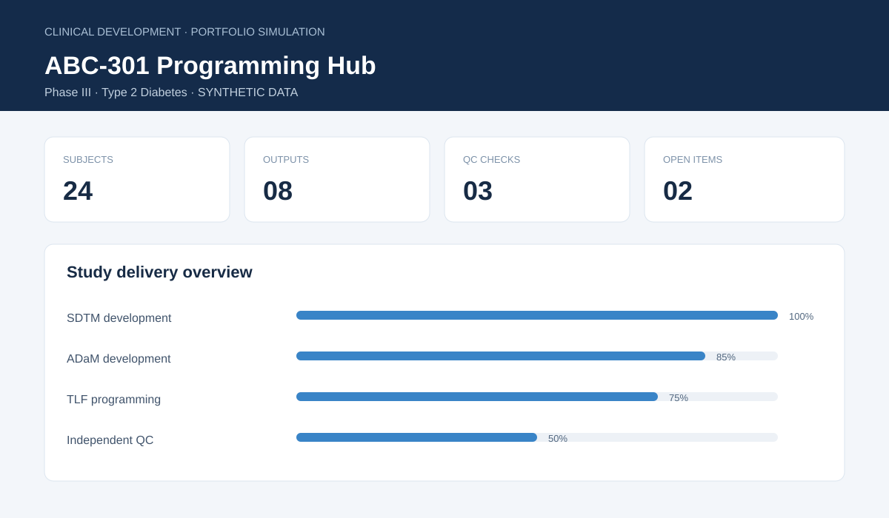
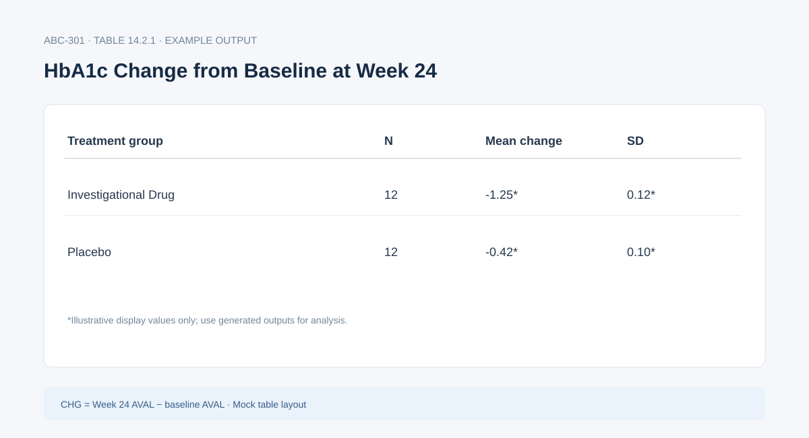

# Clinical Trial Statistical Programming & Regulatory Reporting Hub

Portfolio simulation of a fictional Phase III clinical trial using SAS Base/Macro, R, CDISC SDTM/ADaM concepts, validation/QC, TLF reporting and study-lead oversight.

> Synthetic educational example only. Not a validated clinical system, actual regulatory submission, or evidence of professional study-lead experience. No patient or sponsor data are included.

## Study ABC-301
Fictional randomized, double-blind, placebo-controlled Phase III Type 2 diabetes study. Primary endpoint: change from baseline in HbA1c at Week 24. This starter dataset contains 24 synthetic subjects.

## Included
- Synthetic demographics, laboratory and adverse-event source data
- SAS subject-level and lab analysis programming examples and reusable macros
- R data pipeline, summary tables, plots and QC checks
- SDTM/ADaM mapping and traceability examples
- Validation plan, findings log and study programming plan
- Static study-lead dashboard
- Four screenshot-style SVG portfolio previews in screenshots/

## Run the R pipeline
Install packages readr, dplyr and ggplot2, then run from repository root:
Rscript r/run_pipeline.R
Outputs are written to outputs/. Open dashboard/index.html to view the static dashboard.

## Run SAS examples
Open sas/programs/00_run_all.sas in SAS 9.4+ and update project_root to your local clone path. SAS software is not included.

## Standards and validation limitations
Mappings are illustrative, not a complete SDTM/ADaM implementation. Confirm current CDISC guides, controlled terminology and sponsor standards. Pinnacle 21 execution is not claimed; the repository includes a validation plan and example findings log only.

## Screenshots / visual evidence
### Study dashboard

### TLF preview

### QC validation

### Study lead tracker

These are designed SVG previews, not captured screenshots from a live SAS, RStudio or validated clinical environment.

## Suggested walkthrough
Open the repository and review the README.

Install R and the packages readr, dplyr, and ggplot2.

Run Rscript r/run_pipeline.R from the repository root.

Open dashboard/index.html to view the dashboard.

If you have SAS access, run the programs in sas/programs/
Review the study plan, inspect source data and mappings, run the R pipeline, review SAS programs, then inspect QC and screenshot previews.
